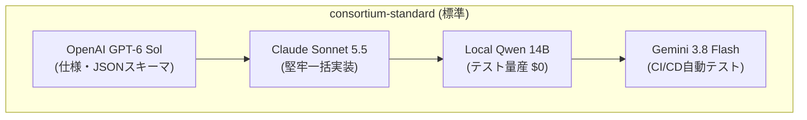

# 📘 4大陣営合同自律開発コンソーシアム 取扱説明書 (User Manual)

本システムは、**Google (Gemini 3.8 Flash)**、**Anthropic (Claude Sonnet 5.5 / Opus 5.5 / Haiku 4.5)**、**OpenAI (GPT-6 Astra / Sol / Luna / o3-mini)**、および **Local AI (Qwen2.5-Coder:14b / RTX 5080)** の4大陣営が適材適所で自動連携し、人間の手動コピペやファイル受け渡しを完全にゼロにして開発を進める自律パイプラインです。

---

## 目次
1. [このシステムでできること](#1-このシステムでできること)
2. [基本的な使い方（2つの操作方法）](#2-基本的な使い方2つの操作方法)
3. [主要コマンドリファレンス](#3-主要コマンドリファレンス)
4. [チームプリセット一覧と使い分け](#4-チームプリセット一覧と使い分け)
5. [4大陣営モデルの役割・強み一覧](#5-4大陣営モデルの役割強み一覧)
6. [自己改善ループ（学習＆推薦）の使い方](#6-自己改善ループ学習推薦の使い方)
7. [安全・FinOpsガードレール（暴走防止）](#7-安全finopsガードレール暴走防止)
8. [トラブルシューティング & FAQ](#8-トラブルシューティング--faq)

---

## 1. このシステムでできること

- **手動コピペゼロ ($0 手間)**:
  「OpenAIで仕様作成 ➔ Claudeで実装 ➔ Qwenでテスト量産 ➔ Geminiで実機検証」の全工程が完全自動でリレーされます。
- **コストと品質の最適化 (FinOps)**:
  高価な上位モデル（Opus/Astra/Sonnet）は要所（設計・実装・監査）のみに限定し、大量のテストコード生成はローカルGPU（完全無料 \$0）にオフロードします。
- **自律学習＆最適チーム推薦**:
  過去のタスク完了実績やエラーから各モデルの得意・不得意を自律学習し、次のタスクに最適なチーム編成を自動提案します。
- **確定値・数理の防衛 (SSOT保護)**:
  計算確定値やゲーム内メタデータをLLMの作文で破壊させない安全バリデータが常時稼働します。

---

## 2. 基本的な使い方（2つの操作方法）

### 方法 A: チャット（Antigravity）に自然言語で依頼する（推奨）
最も手軽な方法です。チャット画面で普段通りに指示するだけで、Antigravityが自律的に適切なチームを招集して実行します。

> **依頼例:**
> - 「3社合同チームで、電力貯蔵バッファのトリップ回避シミュレーターを実装して」
> - 「この要件に最適なチーム編成を推薦して、そのまま開発を進めて」
> - 「暗号化認証モジュールをセキュアチームで実装して」

### 方法 B: ターミナル（PowerShell）から直接CLIで実行する
スクリプトやバッチから直接バトンリレーを起動できます。

```powershell
# 標準チームで自動開発を実行
node scripts/consortium_dispatcher.js "機能の要件・指示プロンプト"

# プリセットを指定して実行（例: セキュリティ特化）
node scripts/consortium_dispatcher.js "JWT認証と権限管理の実装" --preset security-critical
```

---

## 3. 主要コマンドリファレンス

すべてのスクリプトは `scripts/`（またはグローバル `~/.gemini/config/skills/claude-specialist/scripts/`）に配備されています。

| コマンド | 説明 | 主な用途 |
| :--- | :--- | :--- |
| `node scripts/model_learning_engine.js recommend "<要件>"` | タスク特性に応じた**最適チーム編成を自動推薦** | 着手前のチーム決め |
| `node scripts/consortium_dispatcher.js "<指示>"` | **4社合同バトンリレー開発**を即時実行 | 機能開発の本番実行 |
| `node scripts/consortium_dispatcher.js list` | 過去のタスク台帳・進捗ステータス一覧を表示 | 進捗・成果物の確認 |
| `node scripts/model_learning_engine.js retro --task-id <ID>` | 完了タスクの実績から**モデル能力を事後学習** | 開発完了後の知見蓄積 |
| `node scripts/model_learning_engine.js list` | 全モデルの強み・弱み・能力スコア一覧を表示 | 現在のAI戦力確認 |
| `node scripts/token_watcher.js handoff` | チャット引き継ぎ用の最新スナップショットを生成 | スレッド切り替え時 |

---

## 4. チームプリセット一覧と使い分け

`data/consortium/team_presets.json` に定義されている標準編成です。タスクの性質に応じて `--preset <名前>` で切り替えられます。



1. **`consortium-standard` (標準開発チーム - デフォルト)**
   - **構成**: OpenAI Sol ➔ Claude Sonnet 5.5 ➔ Local Qwen ➔ Gemini 3.8 Flash
   - **用途**: 新機能開発、モジュール追加、標準的なビジネスロジック。
2. **`math-logic-heavy` (超深層数理・最適化特化チーム)**
   - **構成**: OpenAI o3-mini (CoT数理) ➔ Claude Sonnet 5.5 ➔ Antigravity 確定ソルバー検証
   - **用途**: シミュレーター、確率計算、ケリー基準、最適化問題。
3. **`security-critical` (セキュリティ・不可逆監査特化チーム)**
   - **構成**: Claude Haiku 4.5 (脅威抽出) ➔ Claude Sonnet 5.5 (防壁実装) ➔ Claude Opus 5.5 (最高峰監査)
   - **用途**: 認証、暗号、決済、不可逆データベースマイグレーション。
4. **`rapid-eco` (高速エコ \$0 ドラフトチーム)**
   - **構成**: Local Qwen 14B (高速ドラフト \$0) ➔ Claude Haiku 4.5 (差分推敲) ➔ Gemini 3.8 Flash (検証)
   - **用途**: 簡単なCRUD雛形、ボイラープレート、PoC試作。

---

## 5. 4大陣営モデルの役割・強み一覧

| 陣営 | 最新モデル名 | 得意な工程 / 主な役割 | 強み・選定理由 |
| :--- | :--- | :--- | :--- |
| **Google** | **Gemini 3.8 Flash** | **司令塔・CI/CD Gate** | 超低遅延、巨大コンテキスト探索、テスト自動実行、自己修復 |
| **Anthropic** | **Claude Sonnet 5.5** | **精密実装・主戦力** | 前世代比で大幅高速化、工業製品レベルの型安全コード生成 |
|  | **Claude Opus 5.5** | **最高峰セキュリティ監査** | 1Mトークン対応、不可逆セキュリティ・数理最終判定 |
|  | **Claude Haiku 4.5** | **高速リスク抽出・前処理** | 超低コスト・超高速での論点整理、Sonnetへの入力圧縮 |
| **OpenAI** | **GPT-6 Astra** | **自律エージェント・戦略** | 最新フラッグシップ、極限推論、複雑な多目的最適化 |
|  | **GPT-6 Sol** | **仕様策定・APIスキーマ** | 抜け漏れのない要件定義書、Structured Outputs厳格準拠 |
|  | **GPT-6 Luna** | **超軽量前処理・要約** | 超低コスト・高速のJSON成形、ログ圧縮（トークン節約） |
|  | **o3-mini** | **数理・論理推論** | Hidden CoTによる物理・数学計算の厳密な論理証明 |
| **Local AI** | **Qwen2.5-Coder:14b** | **テスト高速量産 (\$0)** | 完全無料、RTX 5080 による秒速の単体テストコード量産 |

---

## 6. 自己改善ループ（学習＆推薦）の使い方

システムは使うほど賢くなります。**タスクが完了するたびに、バトンリレーエンジンが自動的に自己改善ループ（Retro）を毎回実行し、各モデルの知見とスコアを更新します。**

```bash
# 【自動実行】通常は開発完了時にシステムが自動で Retro を実行し学習します。
# （手動で追加学習や個別確認を行いたい場合のコマンド）:

# 1. 任意の完了タスクの実績を手動で再学習させる
node scripts/model_learning_engine.js retro --task-id "TASK-20260930-68DP"

# 2. 個別の気づきや教訓を手動で登録する
node scripts/model_learning_engine.js learn --model "claude-sonnet-5.5" --insight "800行超の実装時は前処理で論点を絞ると安定する" --score-delta 1

# 3. 現在の全社モデル能力スコアと学習知見を確認する
node scripts/model_learning_engine.js list
```

---

## 7. 安全・FinOpsガードレール（暴走防止）

| ガードレール機能 | 仕組み・動作条件 | 効果 |
| :--- | :--- | :--- |
| **Hard-Cap (呼び出し上限)** | 1時間あたり最大30回（環境変数で変更可）に達すると自動遮断 | APIキーの不正使用・無限ループによる課金爆発を完全防止 |
| **Timeout (タイムアウト)** | 1リクエスト最大180〜240秒で自動キル | プロセスハングや課金浪費を遮断 |
| **Anti-Context-Bloat** | チャットが15〜20ターンに達すると【🔔 新チャット切り替えの合図】を出力 | 25万トークンの雪だるま式肥大化（O(N^2)課金）をリセット |
| **Safe Rulebook Gate** | ルール変更時に `safe_rulebook_update.py` を通し、構文・500行上限・危険コマンドを検査 | 設定ファイルやプロンプトの自己破壊を遮断 |
| **Deterministic Validator** | `tests/unit/test_deterministic_validator.py` で確定計算値を物理検証 | LLMによる確定メタデータの改竄・ハルシネーションを防止 |

---

## 8. トラブルシューティング & FAQ

### Q1. タスク実行中にタイムアウト（240秒超過）エラーが出た
- **原因**: 800行を超える長大なコードを一括生成しようとしたか、直列で重い前処理を挟んだ可能性があります。
- **対処法**: タスクを2つの小さな機能に分割するか、仕様策定（Step 1）で出力モジュールを2つに指定してください。

### Q2. テストコード実行でインポートエラーが出た
- **原因**: Local Qwen がテストを生成する際、対象モジュールの未公開例外クラスなどをインポートしようとしたケースです。
- **対処法**: Step 4（Gemini 3.8 Flash）が自動で検知してインポート文やアサーションを自己修復します。修復されない場合は「インポートを修正してテスト再実行して」と指示してください。

### Q3. チャットの動作が重くなってきた / トークン消費が増えてきた
- **対処法**: ワンタッチ引き継ぎを行ってください。
  1. ターミナルで `node scripts/token_watcher.js handoff` を実行（またはAntigravityに「引き継ぎ作って」と指示）
  2. 新しいチャット画面を開き、以下の1行を送信するだけで初期トークン（約4,000 tokens）から即座に再開できます：
     ```text
     C:\Users\s8933\.gemini\config\council_logs\handoff_latest.md を読み込んで、前回の作業を引き継いで続きを開始してください
     ```
