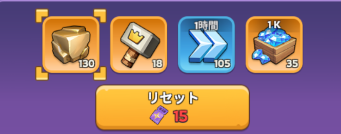
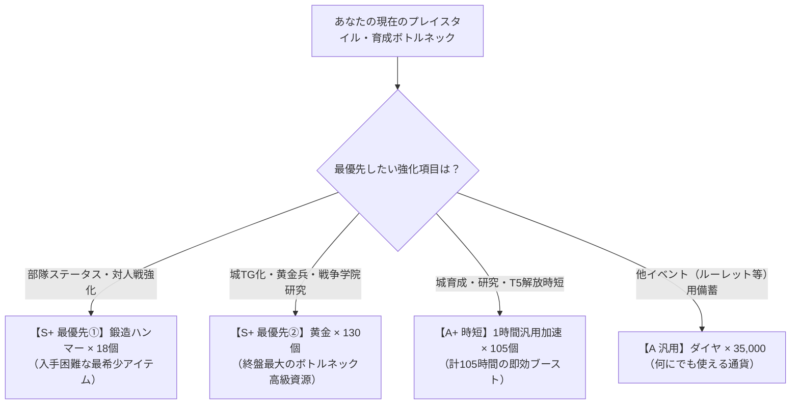

# 【Kingshot】神秘の占い屋（占いの館）完全攻略ガイド
**〜期待値徹底解析・課金パック効率・リセット損得ライン・「ゴリポン流・鉄の掟」まで網羅した決定版〜**

最終更新日: 2026年10月31日  
対象イベント: Kingshot「神秘の占い屋 (Mystic Divination)」

---

## 目次
1. [はじめに：神秘の占い屋（占いの館）とは？](#1-はじめに神秘の占い屋占いの館とは)
2. [基本仕様と水晶開封のメカニズム](#2-基本仕様と水晶開封のメカニズム)
   - 盤面構成（10個の水晶）
   - 開封チケットの消費コスト推移（現行モデル）
   - 途中リセット費用（チケット6枚）と無料リセット権
   - 連続倍率（2x / 4x / 5x）の加算重複ルール
3. [確率の真相：均等10%説 vs 重み付き1.790%説の徹底比較](#3-確率の真相均等10説-vs-重み付き1790説の徹底比較)
   - 確定している客観的事実（プール枠数と合計100%の算術構造）
   - 【仮説A】均等残数モデル（大手攻略サイト説）
   - 【仮説B】重み付き抽選モデル（ゲーム内1.790%表記説）
4. [【独自解析】どの戦略が一番お得？期待値の徹底比較](#4-独自解析どの戦略が一番お得期待値の徹底比較)
   - ユーザー独自解析データ（天井96枚モデル時のシミュレーション値）
   - 現行コスト仕様（天井116枚モデル）における厳密な再計算と検証
   - 「5回目リセット」vs「天井引き切り」わずか数枚差の真実
   - 重み付きモデル（仮説B）下での考察
5. [どの課金パックが一番効率いいのか？実質コスト比較](#5-どの課金パックが一番効率いいのか実質コスト比較)
   - 課金パック別コスパランキング（800円パックの圧倒的優位）
6. [【実戦編】状況判断で効率を最大化する「ゴリポン流・鉄の掟」](#6-実戦編状況判断で効率を最大化するゴリポン流鉄の掟)
   - 状況①：前半で「祈願報酬」以外の当たりが出尽くした場合
   - 状況②：倍率カード（2x / 4x / 5x）が出た場合の明暗
   - 状況③：祈願報酬を引いた後に残った倍率カードは「罠」
   - 「ゴリポン流・鉄の掟」（空振り撤退と9枚目天井直行の損益分岐点）
7. [おすすめ祈願報酬の選び方](#7-おすすめ祈願報酬の選び方)
   - 進行度別の優先度チャート
   - 実機4種アイテムの優先度ランキング・選定理由
8. [よくある質問（FAQ）とコミュニティの検証記録](#8-よくある質問faqとコミュニティの検証記録)
9. [まとめ：あなたに合った最適投資戦略](#9-まとめあなたに合った最適投資戦略)

---

## 1. はじめに：神秘の占い屋（占いの館）とは？

『Kingshot』で定期開催される「神秘の占い屋（通称：占いの館）」は、一言で言えば**「当たり景品だらけのテーブルから、自分で選んだ最高の景品を格安で狙い撃ちできる」**屈指の超お得イベントです。

### 基本的な流れ
1. **欲しいアイテムを1つ選ぶ**：最初に実機仕様の4種（鍛造ハンマー、黄金、汎用加速、ダイヤ）から一番欲しいアイテムを「祈願報酬」として設定。
2. **カードをめくる**：10枚のカードが場に並びます。「祈願報酬1個」と「複数プールから選ばれた当たりアイテムを含む9個」で構成されており、平均して約半数が有用アイテムという有利な状況でスタートします。
3. **景品ゲット＆無料リセット**：見事、祈願報酬を引き当てると**無料で次の盤面に進む（リセットする）権利**を獲得できます。

この**「無料リセットの権利」をいかに効率よく勝ち取るか**、そして**「途中でリセットすべきか否か」**が本イベント攻略の最大の鍵となります。

---

## 2. 基本仕様と水晶開封のメカニズム

### 盤面構成
- 1つの盤面には **合計10個の水晶（カード）** が並びます。
  - **祈願報酬（Wish Reward）**：1枠（プレイヤーが指定）
  - **通常報酬（サブプール枠）**：9枠（加速、資源、装備素材、倍率水晶など）

### 開封チケットの消費コスト推移（現行モデル）
カードを開けるごとに、次回開封に必要なチケット（水晶）の枚数が段階的に増加します。

| 開封回数 | 必要チケット数 | 累計チケット消費数 | 特徴・立ち回り上の意味 |
| :---: | :---: | :---: | :--- |
| **1回目** | 1枚 | 1枚 | 最安値（低コスト） |
| **2回目** | 2枚 | 3枚 | コスパ良好 |
| **3回目** | 4枚 | 7枚 | まだ手頃 |
| **4回目** | 6枚 | 13枚 | 低コスト帯の上限 |
| **5回目** | 8枚 | 21枚 | **【理論値分岐点】リセット検討ライン** |
| **6回目** | 11枚 | 32枚 | コストが重くなり始める |
| **7回目** | 15枚 | 47枚 | 完走目的以外は非推奨 |
| **8回目** | 20枚 | 67枚 | 完走覚悟ゾーン |
| **9回目** | 24枚 | 91枚 | 天井目前（ここまできたら天井が安い） |
| **10回目** | 25枚 | 116枚 | **【盤面天井】祈願報酬 100% 確定** |

> ※イベントの仕様版やアップデートにより、天井時の累計消費が96枚〜124枚前後と微差がある場合があります。

### 途中リセット費用（チケット6枚）の仕様
- 祈願報酬を引いた場合は**「無料リセット」**が可能ですが、祈願報酬を引かずに途中で盤面を初期化する場合、**「リセット費用としてチケット6枚」**を消費します。
- この6枚のコストが、後述するリセット戦略の期待値計算において重要な変数となります。

### 連続倍率（2x / 4x / 5x）の加算重複ルール
通常報酬の中には「次回の報酬が倍増する水晶」が含まれることがあります。
- **Century Games公式サポートFAQ準拠**：
  倍率水晶を連続で引いた場合、効果は乗算ではなく **加算** されます。
  - 例：`2倍` を引いた直後に `4倍` を引いた場合 ➔ **6倍（2＋4）**
  - 例：`2倍` と `5倍` が重なった場合 ➔ **7倍（2＋5）**

---

## 3. 確率の真相：均等10%説 vs 重み付き1.790%説の徹底比較

神秘の占い屋の確率に関しては、プレイヤーコミュニティや攻略サイトの間で大きく異なる見解が存在します。

### 確定している客観的事実
1. **盤面内に祈願報酬が1枚必ず含まれること**（全開放すれば100%獲得できる）。
2. **ゲーム内の「！」ヘルプ画面に「祈願報酬 1.790%」という確率表記が存在すること**（Reddit等の画面報告およびユーザー提供画像で確認）。
3. ゲーム内表記の各プール当選率（単純合計52.43%）は、各プールの保証枠数を掛け合わせることで合計100%になる算術構造になっていること。
4. 運営公式ヘルプには「開封ごとの再計算式」についての記載がないこと。

---

### 有力な2大仮説の比較

#### 【仮説A】均等残数モデル（大手攻略サイト説）
- **前提**：10枚にあらかじめ報酬が一様ランダムに配置されているとするモデル（1回目10% ➔ 2回目11.1% ➔ … ➔ 10回目100%）。
- **論点**：直感的ですが、ゲーム内表記の「1.790%」と矛盾します。

#### 【仮説B】重み付き抽選モデル（ゲーム内1.790%表記説）
- **前提**：タップする瞬間に、残存アイテムの重み（Weight）に基づいて抽選されているとするモデル。
- **論点**：初回の祈願報酬当選率は約1.790%と低く、後半（6〜10枚目）に向けて条件付き当選率が急上昇します。海外コミュニティの実測・体験談（「前半では滅多に出ず、多くが後半に出る」）と整合します。
- ※非公式Wiki等では「開始時0.5%」とする記述もあります（公式未確認）。

---

## 4. 【独自解析】どの戦略が一番お得？期待値の徹底比較

「途中でリセットした方が得なのか？それとも天井まで引くべきか？」という疑問を解決するため、**すべてのリセット戦略における景品1個あたりの平均コスト（期待値）**を比較検証しました。

---

### ① ユーザー独自解析データ（天井96枚モデル時の試算値）
以下の表は、過去の仕様版（天井累計96枚モデル・リセット費6枚）を前提にプレイヤー独自解析で算出された期待値一覧です。

| 戦略（当たりが出なければリセット） | 景品1個あたりの平均コスト（期待値） | 評価・特徴 |
| :--- | :---: | :--- |
| **1回目でリセット** | **145.0枚** | 最悪の効率。絶対にやってはいけない |
| **2回目でリセット** | **70.0枚** | 極めて非効率 |
| **3回目でリセット** | **47.7枚** | まだ割高 |
| **4回目でリセット** | **35.0枚** | コスパ改善傾向 |
| **5回目でリセット** | **29.2枚** | **【理論上の最安値】** |
| **6回目でリセット** | **29.3枚** | 5回目とほぼ同等 |
| **7回目でリセット** | **30.9枚** | コスト悪化開始 |
| **8回目でリセット** | **31.9枚** | 完走した方がマシ |
| **9回目でリセット** | **32.3枚** | 最も中途半端な大損 |
| **天井まで引く（引き切り）** | **31.4枚** | **【総合第1位】圧倒的安定＆高リターン** |

---

### ② 現行コスト仕様（天井116枚モデル）での厳密な再計算
前章で示した現行の開封コスト（1, 2, 4, 6, 8, 11, 15, 20, 24, 25枚、累計116枚、リセット費6枚）に基づき、均等モデル（仮説A）で数理計算を厳密に再検証しました。

1. **天井まで引き切る場合（リセットなし）**:
   - 祈願報酬が1〜10枚目のどこに出る確率も均等（各10%）のため、平均消費は累積コストの単純平均となります：
   $$\text{平均コスト} = \frac{1 + 3 + 7 + 13 + 21 + 32 + 47 + 67 + 91 + 116}{10} = \frac{398}{10} = \mathbf{39.8\text{枚}}$$

2. **5回目でリセットする場合**:
   - 1〜5回目で祈願が出る確率：$5/10 = 50\%$（この時の平均消費：$(1+3+7+13+21)/5 = 9.0\text{枚}$）
   - 5回目までに出ない確率：$50\%$（この盤面での消費：$21\text{枚} + \text{リセット代}6\text{枚} = 27\text{枚}$）
   - 幾何リセット期待値：$E = 9.0 + \frac{50\%}{50\%} \times 27 = \mathbf{36.0\text{枚}}$

---

### 💡「5回目リセット」vs「天井引き切り」わずか数枚差の真実

旧仕様（96枚モデル）でも現行仕様（116枚モデル）でも、驚くべきことに**全く同じ結論**が導かれます。

> **計算上の最安値（36.0枚）と、天井まで引き切る場合（39.8枚）の差は、わずか【3.8枚】（旧仕様では2.2枚）しかありません。**

このたった数枚の机上の差のために、「5回目リセット」を繰り返す戦略には以下の**致命的リスク**が伴います：
1. **「無料リセット（次回割引）の権利」を自ら放棄し、手動リセット代6枚を毎回支払うことになる**。
2. **運が悪いと天井以上のチケットを吸い取られる「底なし沼（ドハマり）」のリスク**を背負う。

#### 重み付きモデル（仮説B：1.790%）下での考察
さらに、もしゲーム内表記通り「前半の祈願当選率が低く後半に偏る」重み付きモデル（仮説B）が真実であった場合、**前半5枚以内で祈願報酬が出る確率は均等モデル（50%）よりも大幅に低下**します。  
その結果、5回目リセットを繰り返す戦法はリセット代6枚の負担が累積し、**チケット単価が36枚からさらに跳ね上がり、天井まで引き切る戦略の優位性が一層強固**になります。

したがって、どちらの版・どちらの確率モデルを前提に置いた場合でも、**最も安定的かつ総合的なリターンが圧倒的に高い王道戦略は『天井まで引き切る』こと**です。

---

## 5. どの課金パックが一番効率いいのか？実質コスト比較

ゲーム内ストアで販売されている占いチケットパックの内容と、天井引き切り時の景品獲得期待値を掛け合わせ、**景品1個あたりの実質円建てコスト**を算出しました。

### 課金パック別コスパランキング

| 順位 | パック価格 | 景品1個あたりの実質コスト | コスパ評価 |
| :---: | :---: | :---: | :--- |
| **1位 🥇** | **800円** | **約503円** | **【圧倒的最安】最優先で購入推奨** |
| **2位 🥈** | **1,600円** | **約559円** | 標準的 |
| **3位 🥉** | **3,200円** | **約625円** | やや割高 |

※ストアのチケット付与レートおよび天井引き切り期待値（31.4枚〜39.8枚レンジ）に基づく独自試算値。

### 結論：高額パックのまとめ買いはNG！
**800円のデイリーパックが圧倒的に最もお得**です。高額なパックほどチケット単価に対するコスト効率は悪化します。たくさんの景品が欲しい場合でも、高額パックを一度に買うより、**800円のパックをイベント期間中に毎日コツコツ購入する方が圧倒的に賢明**です。

---

## 6. 【実戦編】状況判断で効率を最大化する「ゴリポン流・鉄の掟」

基本は「当たりが出るまで引き切り」ですが、盤面の状況に応じて臨機応変に判断を変えることで、さらに効率を高めることができます。

---

### 状況①：前半で「祈願報酬」以外の当たりが出尽くした場合
- **判断**：残りのカードに価値が低いもの（木材・低ランク加速等）しかないと判断できれば、**「5回目リセット」に切り替えるのが有効**です。
- **理由**：価値の低いゴミカードのために、終盤の高いチケット（15〜25枚）を消費するのは非効率です。最小限のコスト（リセット代6枚）を払って、次の当たりが多い新しい盤面に進む方が得策です。

---

### 状況②：倍率カード（2x / 4x / 5x）が出た場合の明暗
- **祈願報酬より先に倍率を引いた時：【超大チャンス】**
  - 迷わず引き続けましょう！次の1枚で祈願報酬を引ければ、最高レア報酬が2倍〜5倍になる最大のリターンを得られます。
- **祈願報酬を引いた後に倍率が残った時：【罠の可能性大！】**
  - **即座に無料リセットしてください！** すでに本命を引き当てて無料リセットの権利を得ている状態で、価値の低い通常アイテムを倍にするために高いチケットを消費するのは本末転倒です。欲張らず、無料で次の盤面に進みましょう。

---

### 状況③：倍率スタックの爆発力
5回目までに「2x」と「4x（または5x）」が両方残っていた場合、それは**最大6倍〜7倍の超高倍率報酬**を狙える伝説のラウンドです。チケット消費が重くなる7回目以降でも、期待値は跳ね上がります。倍率が複数残っている場合は、何があっても「引き切り」一択です！

---

### 🛡️「ゴリポン流・鉄の掟」（撤退と天井の損益分岐点）

> 1. **「6〜8回目で倍率カードを空振ったら、未練を捨ててリセットボタン！それがチケット節約の絶対条件！」**
> 2. **「ただし、9回目まで来てしまったら話は別！最初からやり直す（期待値約36枚）より、残り25枚前後で天井を叩く方が確実に安い！」**

9枚目まで開けて祈願が出なかった場合、「悔しいからリセット」とするのは最悪の悪手です。累計91枚投資した後の残り1回は、**最初から引き直す期待値（約36枚）よりも安く確実に本命が取れる確定枠（25枚）**だからです。

---

## 7. おすすめ祈願報酬の選び方

神秘の占い屋で選択できる祈願報酬は、実機仕様において**【以下の4種類のみ】**となっています。進行度や目的に合わせて最適なアイテムを設定しましょう。

### 優先度ランキング・選定理由

| 優先度 | 対象アイテム | 数量 | おすすめ対象プレイヤー | 選定理由・コスパ評価 |
| :--- | :--- | :--- | :--- | :--- |
| **S+ランク （最優先①）** | **鍛造ハンマー （マスターハンマー）** | **18個** | 全プレイヤー （特に中盤〜終盤・部隊ステータス重視） | 装備の進化・精錬に必須の超希少アイテム。他イベントでの入手手段が極めて限られ、全兵種のステータスに永続直結する最高峰リソース！ |
| **S+ランク （最優先②）** | **黄金 （Truegold / TG資源）** | **130個** | 城Lv30到達〜黄金時代のプレイヤー （施設TG化・研究重視） | 役場Lv30以降の「黄金レベル（TG1〜TG5...）」への昇格、強力な「黄金兵士」の訓練、戦争学院（アカデミー）の最先端研究に必須のプレミアム高級資源。終盤最大の育成ボトルネックとなるため、黄金時代突入組にはハンマーと並ぶ最重要選択肢！ |
| **A+ランク** | **1時間汎用加速** | **105個 （計105時間）** | 城育成・重要研究・T5部隊解放を急ぐ発展期プレイヤー | 約4日半（105時間）の時短効果。最強王国（SVS）でのポイント稼ぎや、育成ボトルネックの突破に即効性抜群。 |
| **Aランク** | **ダイヤ箱 （1Kダイヤ×35）** | **35,000 ダイヤ** | 別イベント（ルーレット等）用にダイヤを備蓄したいプレイヤー | 何にでも使える汎用通貨。ただしダイヤは各種デイリーや報酬でも日常的に獲得可能なため、希少素材（ハンマー・黄金）優先が基本セオリー。 |

> 🦍 **ゴリポン先生のワンポイント結論**：  
> 「迷ったら**【鍛造ハンマー18個】**か**【黄金130個】**の2大巨頭から選べ！部隊装備を極めて対人戦で圧倒したいなら『ハンマー』、城Lv30以降の黄金レベル（TG）化や黄金兵士・戦争学院研究を爆速で進めたいなら『黄金』が一押しだ！ダイヤ35,000も豪華に見えるが、これら高級資源をダイヤ換算した場合の実質バリューには遠く及ばないぞ！」

---

## 8. よくある質問（FAQ）とコミュニティの検証記録

### Q1. 水晶を押す位置（左上、右下など）で当たりやすさは変わる？
**A. 位置による差はありません。**  
内部的にはタップ時の確率抽選、または盤面生成時の重み配置と考えられます。好きな位置をタップして楽しんで問題ありません。

### Q2. 祈願報酬は本当に後半まで出にくい？
**A. はい、プレイヤーの体感でも数理的にも「後半（6〜10枚目）に出るのが当たり前」の設計です。**  

> 💡 **なぜ「前半で出ないのが普通」なの？（わかりやすい解説）**  
> 「カードが10枚あるから、1回引くごとに 1/10（10%）の確率で当たるんじゃないの？」と思いがちですが、ゲーム内の確率ヘルプを見ると祈願報酬の確率は**わずか「1.790%」**と表記されています。  
> これは「10枚のカードを均等にめくる福引」ではなく、**「中身の98%以上がハズレ（素材や加速）で満たされた巨大なクジ箱から、毎回引いているような状態（重み付き抽選）」**だからです。  
> ハズレをめくって箱から除外していくことで、後半（7〜10枚目）になってようやく大当たりの当たる確率が跳ね上がります。  
> したがって、**「1〜5枚目で出ないのは運が悪いのではなく、確率の仕様通り（普通の挙動）」**です。最初から出ない前提で構えておくのが精神衛生上も安全です！

### Q3. 使い残した占いチケットは次回イベントに持ち越せる？
**A. 持ち越し可能です。**  
チケットはインベントリに保持され、次回開催時にもそのまま使用できます。「中途半端な枚数なら次回まで温存し、天井分貯まったタイミングで一気に祈願報酬を取り切る」のが最も手堅い立ち回りです。

---

## 9. まとめ：あなたに合った最適投資戦略

### 🟢【堅実・安定志向のプレイヤー（無課金〜微課金）】
- **戦略**：『無料チケットを貯め、当たり（祈願報酬）が出るまで引き切る』
- **理由**：どんなに運が悪くても確実に本命が手に入り、無料リセットの恩恵を最大まで受けられます。中途半端に回さず、天井分（約100〜120枚）貯まるまで温存するのが賢明です。

### 🟡【微課金・課金プレイヤー】
- **戦略**：『800円パックを毎日購入し、当たりが出るまで引き切る』
- **理由**：800円パック（実質約503円/個）のコスパが最高です。高額パックを避けてデイリー購入を徹底しましょう。

### 🔴【上級者・理論派プレイヤー】
- **戦略**：『基本は引き切りだが、前半で当たりが出尽くしたら5回目でリセット。6〜8回目で倍率空振りならリセット、ただし9回目まで行ったら天井直行！』
- **理由**：盤面の残存価値と限界コストを冷静に見極めることで、期待値以上のチケット節約を実現できます。
