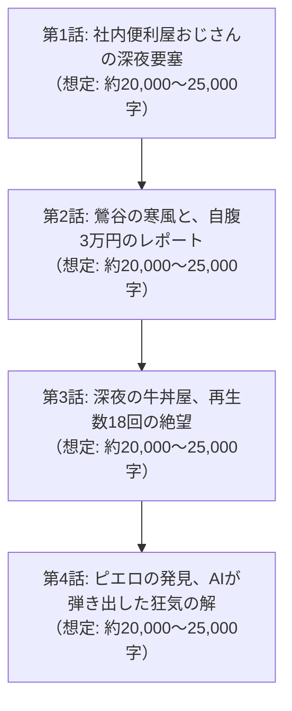

# 📖 携帯小説『アングラ・バカロード』第0章 マスタープロット設計書
**文書番号**: `DOC-NOVEL-CH0-20261011`  
**ボリューム設計**: 全4話構成 / 文庫本1冊分相当（合計 約80,000〜100,000文字）  
**執筆陣体制**: 
- **最高顧問 (Grand Director)**: Claude Opus 5.5
- **メイン執筆 (Lead Novelist)**: Claude Sonnet 5.5
- **プロット・構造化 (Story Architect)**: GPT-6 Sol
- **編集長・進行管理 (Editor-in-Chief)**: Gemini 3.8 Flash
- **整形・校正 (Format & Proofreader)**: Local Qwen 14B ($0)

---

## ■ 第0章の全体テーマ & ログライン
> **「パソコンだけが得意な冴えない40男が、夜の街と最新AIを掛け合わせた時、最初の火花が散った。」**  
> 誰の記憶にも残らず消えていく恐怖と劣等感を抱えた中年男が、手取りから3万円を削り、鶯谷の路地裏へ突撃する。  
> 再生数18回の胃酸逆流する絶望の果てに、自作AIのデータ分析が弾き出したのは――『日本一情けないピエロ』という狂気の生存戦略だった。

---

## ■ 各話詳細構成（文庫本1冊分・全4話ボリューム配分）

---

### 【第0章 第1話】社内便利屋おじさんの深夜要塞
* **想定ボリューム**: 約20,000〜25,000文字
* **主な舞台**: 都内の中小企業オフィス ⇄ 郊外の築35年木造ボロアパート
* **詳細プロット展開**:
  1. **昼の屈辱と透明人間の日常**:
     - 40歳目前、独身、彼女いない歴＝年齢に近い主人公「男」（後のP）。
     - 昼間は社内で「PCのトラブルシューター兼Excelマクロ便利屋」。若い女子社員から「おじさん、これ印刷できないんですけど」「マクロ動かないです」とパシリ同然に使われる。
     - 感謝もされず、給料も上がらず、手取り20万そこそこ。同期は課長になり家族を持ち、マイホームを購入している現実との隔絶。
  2. **夜の自作PC要塞**:
     - 家賃5万円のボロアパート。部屋の家具は粗末だが、中央に鎮座する自作ハイスペック水冷PCと4台のマルチモニターだけが青白く発光している。
     - ローカルLLM（最新AIモデル）、Pythonスクレイピング環境、自作の画像・音声解析ツール。
     - ネットとプログラムだけが男の唯一の居場所であり、絶対的な王国。
  3. **アングラ未開拓地への着目**:
     - 「このまま誰の記憶にも残らず、孤独死してゴミとして処理されるのか？」という底知れぬ劣等感と恐怖。
     - ネット上の誰もまだロジカルにデータ化・映像化していない未開拓のブルーオーシャン＝「夜の歓楽街・風俗のリアル検証」に目を付ける。
  4. **第一歩の決意**:
     - 給料日、ATMで引き出した「なけなしの3万円」を茶封筒に入れる。型落ちスマホとピンマイクを握りしめ、夜の街へ踏み出す。

---

### 【第0章 第2話】鶯谷の寒風と、自腹3万円のレポート
* **想定ボリューム**: 約20,000〜25,000文字
* **主な舞台**: 鶯谷・西川口の歓楽街、雑居ビルの激安店、凍える路地裏
* **詳細プロット展開**:
  1. **AIスクレイピングによる店舗ハック**:
     - 風俗口コミサイト、掲示板、Xの膨大なポストを自作スクリプトで収集。
     - サクラや業者のステマレビューを自然言語処理AIで完全排除し、生々しい口コミから「本当に接客が良い隠れた名店」と「圧倒的な地雷店」を数値化。
  2. **生々しい潜入レポート**:
     - 鶯谷の薄暗い雑居ビル。異臭のするエレベーターと湿ったカーペット。
     - 1万4,000円を震える手で支払い、カーテンで仕切られた薄暗い小部屋へ。
     - ぎこちない会話、キャストの冷めた視線、背徳感と情けなさが入り混じる生々しい体験。
  3. **自販機横の孤独な自撮りロケ**:
     - 店を出た直後、冬の寒風が吹き抜ける路地裏。
     - 白い息を吐きながら、スマホのインカメに向かってボソボソと語る。
     - 「自分は冷静なアングラ評論家・ルポライターだ」と気取り、カッコつけて分析を語る滑稽な姿。

---

### 【第0章 第3話】深夜の牛丼屋、再生数18回の絶望
* **想定ボリューム**: 約20,000〜25,000文字
* **主な舞台**: ボロアパートの編集部屋 ⇄ 深夜2時の吉野家
* **詳細プロット展開**:
  1. **不眠不休のAI自動化編集**:
     - 自作の自動テロップスクリプト、音声ノイズ除去、テンポの良いカット割りを駆使し、一人きりで民放バラエティ級の動画を完成させる。
     - 「これでオレの人生は変わる。世界がオレに気付くはずだ」と期待に胸を膨らませてYouTubeにアップロード。
  2. **冷酷すぎる数字の宣告**:
     - 翌夜、残高数百円の財布を握りしめ、深夜2時の牛丼屋で一番安い並盛りを注文。
     - 冷や汗を流しながらYouTube Studioを何度もリロード。
     - **【再生回数：18回 / 高評価：0 / コメント：1件】**
     - 唯一のコメント：『きもいおっさん。声がネチャネチャしてて吐き気する。死ね』。
  3. **胃酸の逆流と親からの着信**:
     - 店のトイレに駆け込み、胃酸を吐き出す。
     - タイミング悪く実家の母親から着信。「あんた、いつまで一人でそんな生活続けるの……？」。
     - 惨めさ、情けなさ、自己嫌悪で涙が止まらなくなる。

---

### 【第0章 第4話】ピエロの発見、AIが弾き出した狂気の解
* **想定ボリューム**: 約20,000〜25,000文字
* **主な舞台**: 深夜のボロアパート（マルチモニターの前）
* **詳細プロット展開**:
  1. **カットし忘れた事故映像**:
     - 実は動画の途中に、店の前でキャッチのギャルにカッコつけて声をかけ、「うわっ、おじさんキモ！ 財布見せてよ、貧乏くさ！」とボロクソに罵倒されて逃げ出した情けないハプニングが数秒だけ誤混入していた。
  2. **AIアクセス解析の異常スパイク**:
     - 自作の視聴維持率AIグラフを確認した男は驚愕する。
     - カッコつけた解説部分は全員即離脱していたが、**ギャルに罵倒されて情けなくビビっている数秒間だけ、維持率が200%に垂直跳ね上がっていた**。
  3. **魂の覚醒（ピエロ戦略の誕生）**:
     - 「世間が求めているのは、偉そうな評論家じゃない。」
     - 「女にコテンパンに叩きのめされ、金を毟り取られて泣きべそをかく――【日本一情けない中年男】だ！」
  4. **狂気の誓い**:
     - 男としての尊厳、恥、プライドをドブに捨てる覚悟。
     - 深夜の部屋で狂ったように笑い声をあげ、チャンネル名を書き換える。
     - **『Pの歓楽街地獄巡り』**――ここから伝説が始まる。

---
**ステータス**: プロット確定・保存完了（2026-10-11）
