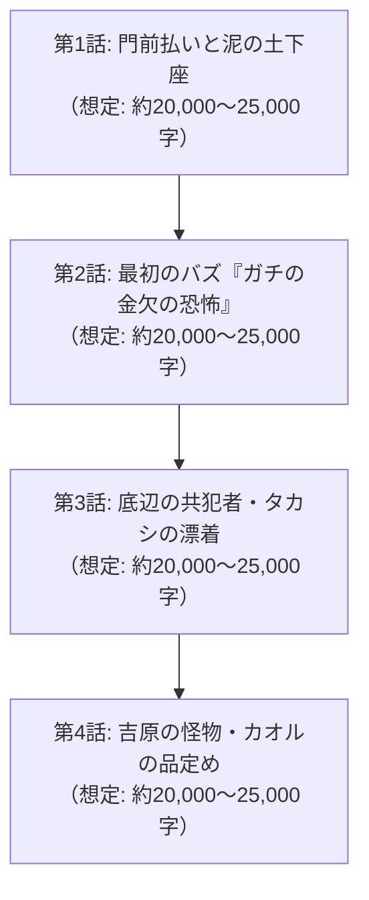

# 📖 携帯小説『アングラ・バカロード』第1章 マスタープロット設計書
**文書番号**: `DOC-NOVEL-CH1-20261011`  
**章タイトル**: 『泥水と金勘定：アングラ同盟の産声』  
**ボリューム設計**: 全4話構成 / 文庫本1冊分相当（合計 約80,000〜100,000文字）  
**執筆陣体制**: 
- **最高顧問 (Grand Director)**: Claude Opus 5.5
- **メイン執筆 (Lead Novelist)**: Claude Sonnet 5.5
- **プロット・構造化 (Story Architect)**: GPT-6 Sol
- **編集長・進行管理 (Editor-in-Chief)**: Gemini 3.8 Flash
- **整形・校正 (Format & Proofreader)**: Local Qwen 14B ($0)

---

## ■ 第1章の全体テーマ & ログライン
> **「ピエロとして生きると決めた男の前に立ちはだかる、歓楽街の冷徹な鉄の掟。」**  
> 撮影拒否、黒服の暴力、伝票4万8千円でリアルに電気代が払えなくなる絶望。  
> 底辺のクズ若者タカシの漂着と、吉原の頂点に君臨する怪物ソープ嬢カオルとのヒリつくビジネス品定め。  
> ヤラセゼロ、打算と泥水の中から、後に日本を揺るがす「アングラ同盟」が産声をあげる。

---

## ■ 各話詳細構成（文庫本1冊分・全4話ボリューム配分）

---

### 【第1章 第1話】門前払いと泥の土下座
* **想定ボリューム**: 約20,000〜25,000文字
* **主な舞台**: 新宿・歌舞伎町または上野・湯島の雑居ビル街
* **詳細プロット展開**:
  1. **『Pの歓楽街地獄巡り』始動の過酷な現実**:
     - ピエロとして生きると覚悟を決めたものの、夜の街は甘くない。
     - スマホを構えてガールズバーやキャバクラの呼び込みに近づくだけで、「おいテメエ何撮ってんだ」「警察呼ぶぞコラ」と黒服やスカウトに胸ぐらを掴まれ、路地裏に引きずり込まれる。
  2. **夜の街の鉄則「身バレと撮影NG」**:
     - キャストの女の子にとって、ネットへの顔出しは「昼の仕事や親バレ、本業退職、ストーカー被害」に直結する絶対のタブー。
     - 宣伝になるどころか、店にとってもただの迷惑な晒し系ユーチューバー扱い。
  3. **Pの武器：自作AIモザイクと店舗データ分析シート**:
     - 諦めないPは、自作Pythonスクリプトで「AIリアルタイム顔面自動追従モザイク＆音声変調技術」を開発（絶対に身バレさせない保証）。
     - さらに、近隣の競合店舗の検索ボリュームと自作AIの集客予測レポートをA4用紙30枚にまとめて印刷。
  4. **泥の土下座交渉**:
     - 湯島の小さなガールズバーの裏口で、店長と黒服に土下座。
     - 「飲食代は全額オレが自腹で払います。女の子の飲食代もオレが払います。店名だけ、概要欄にPRさせてください」。
     - 店長が「……変なことしたらタダじゃ置かねえからな」と、渋々1回だけの店内撮影を許可する。

---

### 【第1章 第2話】最初のバズ『ガチの金欠の恐怖』
* **想定ボリューム**: 約20,000〜25,000文字
* **主な舞台**: 湯島の雑居ビル地下・ガールズバー
* **詳細プロット展開**:
  1. **台本なしの塩対応とカウンターの冷気**:
     - 店内での初ロケ。カウンターの女の子（モア）はカメラに引き気味で、露骨な塩対応。
     - Pは「モテたい勘違い中年」を演じようとするが、トーク力が無さすぎて会話が完全に空回りする。
  2. **容赦ないドリンク攻撃と伝票の跳ね上がり**:
     - 女の子は「お兄さん、一杯もらっていい？」とテキーラやシャンパンを容赦なく連打。
     - Pの目の前で伝票が1万、2万、3万と積み上がっていく。
  3. **ガチの金欠の恐怖と本気の涙目**:
     - 会計が『4万8,500円』に達した瞬間、Pの顔から血の気が完全に引く。
     - 手持ちは銀行残高をかき集めた5万円ポッキリ。これを払ったら、明日からの食費どころか電気代も払えない。
     - 「す、すいません……！ これ以上は本当に、今月の電気が止まります……！」と本気で手を合わせ、財布を抱きしめて情けなく縮こまる。
  4. **ピエロの誕生と爆発的拡散**:
     - その「ガチで金がない男のリアルな恐怖」を見たモアが腹を抱えて大爆笑し、「おじさんマジで金ないの！？ ウケる！」と財布から小銭まで残らず巻き上げる。
     - 編集した動画をアップすると、コメント欄が「これヤラセじゃなくてガチで金尽きてて草」「電気が止まる顔してて草」と大絶賛され、初めて再生数が10万回を突破する。

---

### 【第1章 第3話】底辺の共犯者・タカシの漂着
* **想定ボリューム**: 約20,000〜25,000文字
* **主な舞台**: Pのボロアパート ⇄ 深夜のファミレス
* **詳細プロット展開**:
  1. **動画更新の限界とジモティーでの募集**:
     - 会社勤務を続けながらの撮影・編集に限界が来たP。ジモティーで「動画編集補助・日払い1万円・PC操作できる方」と募集。
  2. **クズ学生タカシの打算**:
     - やってきたのは、大学中退寸前でネットカジノと仮想通貨で200万円の借金を背負い、家賃滞納中のタカシ（語り手）。
     - 最初は「こんな怪しいおっさん、数日適当に作業して日当もらったら、高そうなPCパーツでも盗んで飛ぼう（バックレよう）」と企んでいた。
  3. **深夜のPC要塞で見た怪物の真実**:
     - ボロアパートに入ったタカシは、青白く光る水冷PCと4画面、そしてPが一人で組んだ異常なAI分析システムに息を呑む。
     - さらに、Pが昼の会社の安月給とYouTubeの雀の涙の収益を、生活費に回さずすべて次の撮影費に注ぎ込んでいる狂気を目撃する。
  4. **共犯関係の成立**:
     - 「タカシ、お前借金あるんだろ。オレと一緒に、この街をハックしてみないか？」
     - 逃げるつもりが、中年男の放つ圧倒的な狂気と引力に呑み込まれ、タカシはPの最初の「右腕」として契約を結ぶ。

---

### 【第1章 第4話】吉原の怪物・カオルの品定め
* **想定ボリューム**: 約20,000〜25,000文字
* **主な舞台**: 吉原の最高級ソープランド『華仙（かせん）』
* **詳細プロット展開**:
  1. **吉原の頂点・カオルへの接触**:
     - チャンネル登録者が5万人を超え始めた頃、Pは「次のステージ」として風俗の頂点・吉原への進出を決意。
     - 目をつけたのは、予約半年待ち、月数百万円を稼ぎ出す伝説のキャスト・カオル。
  2. **サラ金からの借金と正規予約**:
     - Pはプロミスから15万円を借り、正規の客としてカオルの80分コースを予約する。
  3. **冷徹なプロの洗礼**:
     - 豪華な部屋で対面したカオル。圧倒的な美貌と、修羅場をくぐり抜けてきた冷たい瞳。
     - Pが「動画に出てほしい。あなたとビジネスを組みたい」と頭を下げた瞬間、カオルは煙草に火をつけ、冷ややかに言い放つ。
     - 「アンタ、頭大丈夫？ 私の客は上場企業の役員や医者よ。なんで素性も知れない泥臭いおっさんの安っぽい動画に、私の看板を貸さなきゃいけないわけ？」
  4. **狂気のデータと命の提示**:
     - Pはひるまず、自作AIが弾き出した「風俗業界のWeb集客ファネル」と「カオルの指名客層の年齢推移データ」、そして「オレを好き放題サンドバッグにしていい権利」を差し出す。
     - カオルは煙草の煙を吐き、Pの目の奥にある「時代に爪痕を残したいという狂気」をじっと見つめる。
     - 「……ふーん。アンタ、いい狂い方してるね。乗ってあげてもいいけど、私の顔に泥塗ったら、この街から消すよ？」
     - 伝説のアングラ同盟が、ここに誕生する。

---
**ステータス**: 第1章プロット確定・保存完了（2026-10-11）
