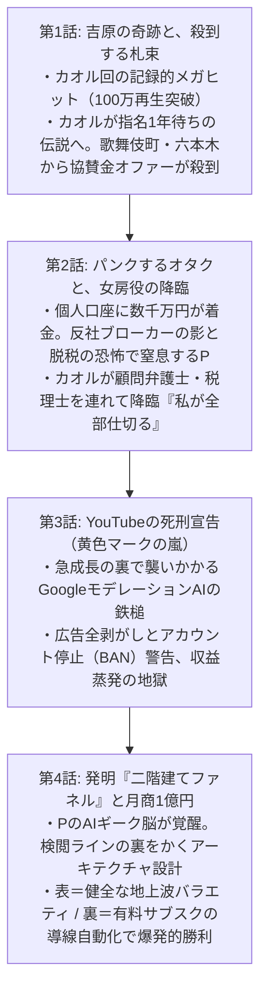

# 📖 携帯小説『アングラ・バカロード』第2章 マスタープロット設計書
**文書番号**: `DOC-NOVEL-CH2-20261011`  
**章タイトル**: 『二階建ての城と、札束の窒息』  
**ボリューム設計**: 全4話構成 / 文庫本1冊分相当（合計 約80,000〜100,000文字）  
**執筆陣体制**: 
- **最高顧問 (Grand Director)**: Claude Opus 5.5
- **メイン執筆 (Lead Novelist)**: Claude Sonnet 5.5
- **プロット・構造化 (Story Architect)**: GPT-6 Sol
- **編集長・進行管理 (Editor-in-Chief)**: Gemini 3.8 Flash
- **整形・校正 (Format & Proofreader)**: Local Qwen 14B ($0)

---

## ■ 第2章の全体テーマ & ログライン
> **「金が人を狂わせ、規約が夢を窒息させる。だが、男の頭脳はさらにその上をハックした。」**  
> 吉原の奇跡のバズから雪崩のように押し寄せる札束、脱税と半グレの恐怖にパンクするオタクP。  
> 伝説の女カオルが裏方の手綱を握り、YouTubeの理不尽な死刑宣告（広告剥がし）を『二階建てファネル』で大逆転。  
> 月商1億円の不沈艦隊が誕生し、狂気の巨大設備投資（特注アクリル熱湯水槽）へと突き進む！

---

## ■ 各話詳細構成

---
**ステータス**: 第2章プロット確定・保存完了（2026-10-11）
