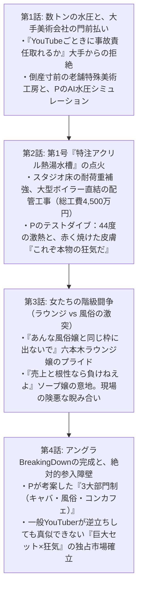

# 📖 携帯小説『アングラ・バカロード』第3章 マスタープロット設計書
**文書番号**: `DOC-NOVEL-CH3-20261011`  
**章タイトル**: 『熱湯の要塞と、女たちの代理戦争』  
**ボリューム設計**: 全4話構成 / 文庫本1冊分相当（合計 約80,000〜100,000文字）  
**執筆陣体制**: 
- **最高顧問 (Grand Director)**: Claude Opus 5.5
- **メイン執筆 (Lead Novelist)**: Claude Sonnet 5.5
- **プロット・構造化 (Story Architect)**: GPT-6 Sol
- **編集長・進行管理 (Editor-in-Chief)**: Gemini 3.8 Flash
- **整形・校正 (Format & Proofreader)**: Local Qwen 14B ($0)

---

## ■ 第3章の全体テーマ & ログライン
> **「稼いだ一億円をすべて美術セットに突っ込み、狂気のアクリル熱湯水槽を築き上げろ。」**  
> 大手美術会社の門前払い、水圧3トンの物理限界と消防法の壁を、Pのデータと町工場の職人魂で突破。  
> 44度の激熱ダイブが生み出す本物のリアクション、そして六本木ラウンジ嬢 vs 吉原ソープ嬢のプライドが激突する『3大部門制』。  
> 一般YouTuberが逆立ちしても追いつけない、アングラ界のBreakingDownがここに完成する！

---

## ■ 各話詳細構成

---
**ステータス**: 第3章プロット確定・保存完了（2026-10-11）
