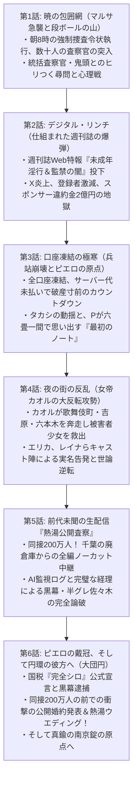

# 📖 携帯小説『アングラ・バカロード』第4章（完結編・超特大3倍ボリューム）マスタープロット設計書
**文書番号**: `DOC-NOVEL-CH4-SUPER-20261011`  
**章タイトル**: 『熱湯の審判：ピエロの戴冠（完結編）』  
**ボリューム設計**: 全6話構成 / 単独で文庫本1冊超（合計 約60,000〜80,000文字 / 各話 約10,000〜13,000文字）  
**執筆陣体制**: 
- **最高顧問 (Grand Director)**: Claude Opus 5.5
- **メイン執筆 (Lead Novelist)**: Claude Sonnet 5.5
- **プロット・構造化 (Story Architect)**: GPT-6 Sol
- **編集長・進行管理 (Editor-in-Chief)**: Gemini 3.8 Flash
- **整形・校正 (Format & Proofreader)**: Local Qwen 14B ($0)

---

## ■ 第4章の全体テーマ & ログライン
> **「全財産凍結、デジタル・リンチ、国家権力（マルサ）の包囲網。すべてを奪われかけたピエロと女帝が、日本のエンタメ史を揺るがす前代未聞の熱湯生配信で世界をひっくり返す！」**  
> 成功の絶頂に仕掛けられた、半グレ・競合事務所・大手週刊誌による悪質な捏造ハニートラップと、東京国税局査察部による一斉ガサ入れ。  
> 口座凍結により兵站を絶たれたP-PROJECTを救うため、吉原の女帝カオルが夜の街の全ネットワークを動員して反転攻勢へ。  
> 同時接続200万人の前代未聞の公開生配信「熱湯公開査察」で黒幕を完膚なきまでに叩き潰し、最後は自ら熱湯へ落ちて日本中を笑わせる。  
> 泥水から始まった39歳中年男の道化芝居、堂々たる完結大河！

---

## ■ 各話詳細構成（今までの3倍：全6話・超特大ボリューム版）

---

### 【第4章 第1話】暁の包囲網：国税査察官の急襲
* **想定ボリューム**: 約10,000〜13,000文字
* **主な舞台**: 上野・P-PROJECTオフィス
* **詳細プロット**:
  1. **午前八時、静寂を破る破城槌**:
     - 徹夜の動画編集を終え、カップ麺をすすっていたPとタカシ。
     - 突然、オフィスの重い鉄扉が激しく叩かれる。「東京国税局査察部だ！ 捜索差押許可状が出ている、開けなさい！」
     - 腕章を巻いた二十名近くの査察官が段ボール箱と青いビニールテープを携えて雪崩れ込み、現場を制圧。
  2. **鬼統括官・鬼頭の冷徹な査察**:
     - 現場の指揮を執るのは、国税局査察部きっての敏腕・鬼頭統括官（五十九歳）。
     - 「三年間で数億円にのぼる使途不明金、架空外注費、海外ダミー法人を利用した所得隠しの嫌疑」。
     - 全ワークステーションPCの押収、外付けHDDの押収、通帳と契約書の差し押さえ。
  3. **密室の心理戦**:
     - 狼狽するタカシに対し、Pは冷静に自作AIのバックアップサーバーの存在を隠しつつ、鬼頭の鋭い尋問に対峙する。
     - 「お前のような素人が、なぜこれほど短期間で億の金を動かせた？ 誰が裏で糸を引いている？」――国家権力とアングラオタクの息詰まる攻防。

---

### 【第4章 第2話】デジタル・リンチ：仕組まれた週刊誌の爆弾
* **想定ボリューム**: 約10,000〜13,000文字
* **主な舞台**: 上野のオフィス 〜 ネットの荒野
* **詳細プロット**:
  1. **正午十二時のWeb特報投下**:
     - ガサ入れの最中、大手週刊誌『週刊文真』のWeb版にスクープ記事が掲載される。
       『【独占告発】月商1億のアングラYouTuber「P」、17歳コンカフェ店員への卑劣な淫行と監禁の全貌』。
     - 顔写真（モザイクなしのPの素顔）と本名が晒され、涙ながらに被害を訴える少女のインタビュー音声。
  2. **ネット世論の狂乱とリンチ**:
     - X（Twitter）のトレンドが『#P逮捕』『#アングラYouTuber性加害』で埋め尽くされる。
     - 登録者数七十万人のチャンネルが、一秒間に百人単位で登録解除の雪崩。
     - まとめサイト、暴露系配信者たちがこぞってハイエナのように群がり、Pのアパートや実家まで特定されて晒される。
  3. **黒幕の正体と巨額違約金**:
     - タイアップ企業から相次ぐ「損害賠償請求（総額二億四千万円）」の通告。
     - そして裏で糸を引くのは、第2章で排除された半グレ・佐々木と、アングラBreakingDownの利権を奪おうとする競合芸能事務所の存在だった。

---

### 【第4章 第3話】口座凍結の極寒：兵站崩壊とピエロの原点
* **想定ボリューム**: 約10,000〜13,000文字
* **主な舞台**: 閉鎖されたオフィス 〜 鶯谷の安ホテル
* **詳細プロット**:
  1. **全資金の凍結と兵站の死**:
     - 国税局による資産保全処分により、会社の全法人口座およびPの個人口座が完全凍結。
     - AWSのサーバー代、オフィスの賃料、スタッフ給与が払えず、あと十日で全インフラが強制停止するタイムリミット。
  2. **タカシの崩壊とPの言葉**:
     - タカシが「もう全部終わりだ……オレたち、犯罪者として一生日陰で生きるしかないんだ」と泣き崩れる。
     - Pは静かにタカシに温かい缶コーヒーを手渡し、自分の原点を語る。
     - 39歳で社内便利屋として誰にも見向きもされなかった日々のこと、鶯谷のドブ川で財布を落とした夜のこと。
     - 「オレたちは最初から何も持っていなかった。失うものなんて最初からないんだよ」。
  3. **冷え切った部屋に響くヒールの音**:
     - 二人の前に、あの女が再び現れる。濡羽色のトレンチコートを着たカオルだった。

---

### 【第4章 第4話】夜の街の反乱：女帝カオルの大反転攻勢
* **想定ボリューム**: 約10,000〜13,000文字
* **主な舞台**: 新宿・歌舞伎町 〜 六本木 〜 吉原
* **詳細プロット**:
  1. **女帝の単身殴り込み**:
     - カオルが吉原の頂点を極めた人脈を総動員し、佐々木らのアジトを特定。
     - 捏造記事で「被害者」として利用されていた17歳の少女・ユイを佐々木らの軟禁場所から救出。
     - 少女は「借金をネタに脅されて、言われた通りの嘘をついただけ」と涙ながらに告白。佐々木の脅迫音声データを完全確保。
  2. **キャストたちの蜂起**:
     - カオルの号令のもと、第3章で熱湯を共にした六本木のエリカ、吉原のレイナ、コンカフェのキャストたちが立ち上がる。
     - 「Pさんはバカでスケベだけど、女の子に無理強いするような男じゃない！」「アタシたちが証明してやる！」
     - 総フォロワー数五百万人を超える夜職インフルエンサーたちが、一斉に実名・素顔で反論動画を投稿。
  3. **世論の動揺と反転の兆し**:
     - デジタル・リンチの空気に、激しい亀裂が入り始める。

---

### 【第4章 第5話】前代未聞の生配信『熱湯公開査察』
* **想定ボリューム**: 約10,000〜13,000文字
* **主な舞台**: 千葉・野田のアクリル熱湯スタジオ
* **詳細プロット**:
  1. **鬼頭統括官への狂気の挑戦状**:
     - Pが神崎弁護士を通じて国税局に持ちかけた前代未聞の条件。
     - 「スタジオで、全帳簿と全防犯ログを生中継で公開査察しろ。もし1円でも脱税があれば全財産返納して豚箱に入る。無実なら査察官、あなたも熱湯に落ちてくれ」。
     - 鬼頭が「職務として逃げる理由はない」と受諾。
  2. **同接200万人突破の超メガ生配信**:
     - YouTubeと独自サロンで緊急生配信が開始。
     - 同時接続数は開始十分で五十万人、一時間で【二百万人】を突破。地上波特番をも遥かに凌駕する社会現象。
  3. **AIログによる完全論破**:
     - Pの自作AIシステムが記録していた、秒単位の防犯カメラ映像、入退室ログ、音声周波数解析をリアルタイム投影。
     - 事件当夜、Pがオフィスの防犯カメラの前でコードを書きながらカップ麺を食べていた完全なアリバイを提示。
     - さらに、少女を脅迫する半グレ佐々木の生音声を全国に大暴露！

---

### 【第4章 第6話】ピエロの戴冠、そして円環の彼方へ（大団円）
* **想定ボリューム**: 約10,000〜13,000文字
* **主な舞台**: 千葉の熱湯スタジオ 〜 数年後の自社ビル
* **詳細プロット**:
  1. **国家権力の公認と、黒幕の失脚**:
     - 生配信のカメラの面前で、鬼頭統括査察官が全仕訳の照合を完了し、マイクを握る。
       「……全帳簿の精査を完了した。合同会社P-PROJECTに所得隠し、脱税の事実は一切認められない。極めて適正、かつ非の打ち所のない経理処理である」。
     - スタジオの外にパトカーが急行し、半グレ佐々木と買収記者を現行犯逮捕。
  2. **同接200万人の前での衝撃の公開婚約発表**:
     - 冤罪を晴らし、完全勝利を収めたスタジオ。マイクを握ったカオルが、突如として日本中を揺るがす重大発表を行う。
     - 「ところで、視聴者の皆様、そして日本中の男たちに、大事なご報告があるわ」
     - 「私、吉原の源氏名カオル――本名・綾瀬薫は、ここにいる世界一情けなくて、世界一無様で、世界一諦めの悪いバカ……『P』こと山田大介と、婚約いたしました」
     - コメント欄のサーバーが吹き飛ぶほどの大爆発！
       『はあああああああ！？』『吉原の女帝が！？』『Pお前マジかよ！！』『全人類の希望だろこれ！！』
     - P「えっ……カ、カオルさん！？ オレ、聞いてませんけど！？」
     - カオル「何言ってんの。アンタの会社の財務も、法務も、人生も、これからは全部私が管理するって言ったでしょ。逃げられると思ってんの？」
  3. **伝説の『熱湯ウエディング・ダイブ』**:
     - コメント欄『婚約したなら熱湯に落ちろ！w』『二人で落ちろ！w』の嵐。
     - P「幸せの絶頂だからこそ……落ちます！！」――48度の熱湯水槽へ渾身のダイブ！
     - カオルも「一生アンタのケツを蹴飛ばしてあげるわよ！」と白いドレスのまま笑顔で飛び込み、タカシも笑い泣きしながら追随する前代未聞の「熱湯ウエディング」！
     - 鬼頭統括官も思わず吹き出し、スタジオ中が爆笑と祝福の涙に包まれる。
  4. **エピローグ：真鍮の南京錠（第0話プロローグとの美しい円環回収）**:
     - 数年後。巨大な自社ビルを構え、日本を代表するエンタメ企業となったP-PROJECT。
     - あの人が倒れた夜、タカシがこじ開けたデスク最下段の真鍮の南京錠。
     - 中から出てきた、あのボロボロの大学ノート、鶯谷の感熱紙レシート、そして――カオルと二人で撮った、熱湯まみれの泥臭い婚約写真。
     - ――【死んでも諦めるな。オレは絶対に、この時代に爪痕を残す】
     - ピエロとして生き、笑われ、泥水をすすりながら最愛の理解者を射止めた男の、永遠の叙事詩が幕を閉じる。

---
