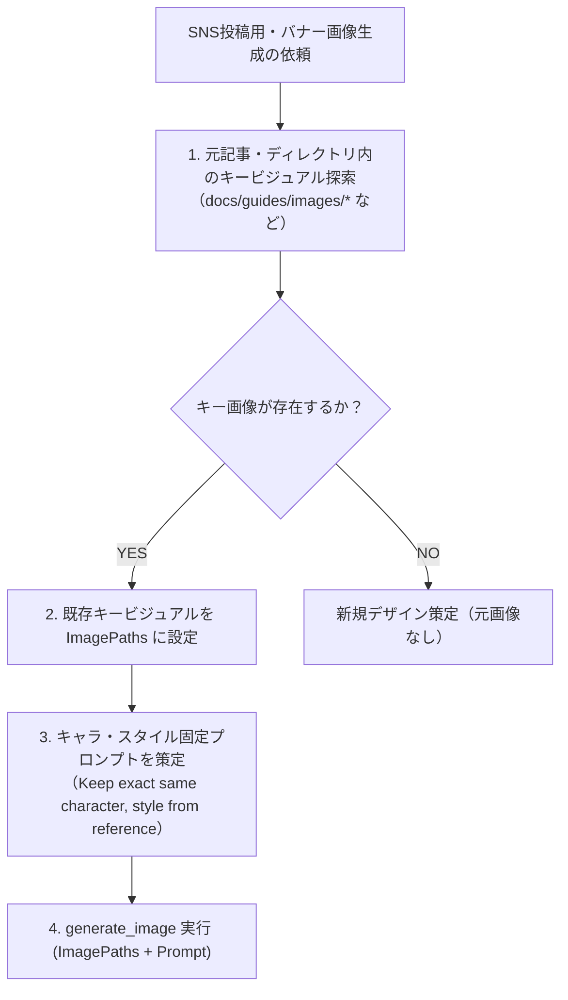

# 元記事画像リファレンス型・一貫性画像生成スキル（Consistent Image Generation Skill）

ブログ記事、攻略ガイド、ドキュメントなどをもとに**SNS（X/Twitter、YouTubeサムネイル、バナー）向けの画像を新規生成する際、元記事に存在するキービジュアルやキャラクターデザインとの「一貫性（Character & Visual Consistency）」を100%維持するための標準運用プロトコル**です。

---

## 1. 鉄の掟（Mandatory Rules）

1. **ゼロからの完全新規生成の禁止（No Unanchored Generation）**:
   - 元記事やプロジェクト内に既にキービジュアル（`*_main_*.png` 等）が存在する場合、**テキストプロンプトのみで画像生成してはならない**。
   - 必ず `generate_image` の `ImagePaths` パラメータに対象画像の絶対パスを指定すること。
2. **キャラクター造形・アートスタイルの完全継承**:
   - プロンプト冒頭で「Keep the exact same character design, costume, hair color, art style from the reference image...」と明記し、髪型、衣装、顔立ち、世界観の乖離を根本から防ぐ。
3. **アスペクト比・構図の再構成（Recomposition）**:
   - 元画像が縦長（9:16等）であっても、X/TwitterやYouTube用に 16:9 や 1:1 に構図を広げて再構成（リコンポジション）するよう指示する。

---

## 2. 実行手順ワークフロー



---

## 3. `generate_image` 呼び出し規約

### 呼び出し例
```javascript
generate_image({
  ImageName: "mystic_divination_x_hook_ref",
  AspectRatio: "16:9",
  ImagePaths: [
    "c:/Users/s8933/.../docs/guides/images/mystic_divination_main_stylized.png"
  ],
  Prompt: "Keep the exact same cute stylized 3D character design from the reference image: the adorable young chibi-style fortune-telling witch with vibrant wavy orange-red pigtails/twintails, cute blue eyes, little heart cheek mark, and oversized purple witch hat with a buckle. Recompose into a 16:9 cinematic widescreen scene..."
})
```

---

## 4. 品質チェックリスト
- [ ] 元画像のキャラクター（髪型、髪色、装飾、服装、瞳の色）と一致しているか？
- [ ] アートスタイル（3D Chibi / アニメ調 / 写実風）が元記事から変質していないか？
- [ ] 指定したアスペクト比（16:9 等）に美しくリコンポジションされているか？
- [ ] テキストやウォーターマークが誤混入していないか？
