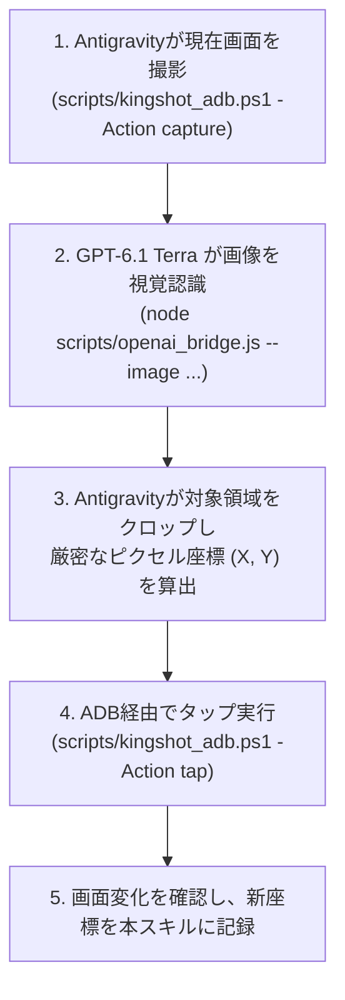

# Kingshot Navigator（自律視覚ナビゲーション＆画面操作スキル）

BlueStacks（Androidエミュレーター）上で動作する『Kingshot』を対象に、**「GPT-6.1 Terra（視覚の頭脳）」** と **「Antigravity（手足・ADB高速実行）」** が連携して自動画面遷移・スクリーンショット取得・UI座標学習を行うスキルです。

---

## 1. チーム編成と役割分担（Visual Hybrid Team）

| 担当 | 役割 | 担当業務 |
| :--- | :--- | :--- |
| **視覚頭脳** | **GPT-6.1 Terra** | 画面スクショのセマンティクス（UI要素・ボタン意図・状態）認識、次の行動決定 |
| **手足・進行** | **Antigravity (Gemini)** | BlueStacksへのADB接続、ピクセル座標の厳密算出、タップ・スワイプ実行、画面撮影 |
| **安全監査** | **Claude Keiba Gate** | 誤課金・ダイヤ消費などの不可逆操作を遮断する安全確認 |

---

## 2. 確定済みUI座標カタログ（解像度: 1080 × 1920 基準）

### ① ホーム（城内画面）
| ボタン・UI | 座標 (X, Y) | アクション |
| :--- | :---: | :--- |
| **通常イベント（巻物）** | `1000, 190` | 通常イベント画面を開く |
| **超得イベント（プレゼント箱）** | `1000, 360` | 超得イベント（神秘の占い屋など）を開く |
| **ビックリ小屋** | `830, 360` | ビックリ小屋を開く |
| **ハロウィン / シーズンイベント** | `830, 190` | 季節イベントを開く |
| **VIP8 アイコン** | `890, 60` | VIP画面を開く |
| **左上戻るボタン（全画面共通）** | `70, 30` | 1つ前の画面に戻る |

### ② 「超得イベント」➔「神秘の占い屋」画面
| ボタン・UI | 座標 (X, Y) | アクション |
| :--- | :---: | :--- |
| **神秘の占い屋タブ** | `190, 110` | 最上部左端の占い屋タブを選択 |
| **確率ヘルプ（！マーク）** | `960, 355` | 祈願報酬1.790%等の確率ポップアップを開く |
| **チケット購入（＋ボタン）** | `970, 430` | チケット所持数の右横から課金パックを開く |
| **祈願報酬アイコン（中央金塊）** | `500, 420` | 祈願報酬の選択リスト画面を開く |
| **カード詳細（右下虫眼鏡）** | `945, 1755` | 盤面カードの詳細・中身を開く |

---

## 3. 自律ナビゲーション手順（Execution Loop）

---

## 4. 新発見の自己学習プロトコル（Continuous Learning）

新しいイベント、画面、ボタンが発見された場合、エージェントは自律的に以下の手順で本スキルを更新します：
1. 発見した画面のスクリーンショットを `docs/guides/images/` に保存。
2. そのボタンのX, Y座標と画面遷移パスを本ファイルの **「2. 確定済みUI座標カタログ」** に追記。
3. ナビゲーション成功の知見としてコミット・永続化する。
